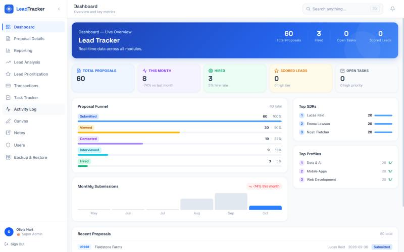
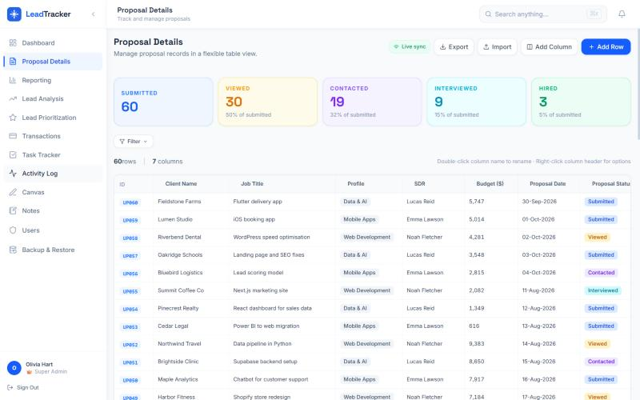
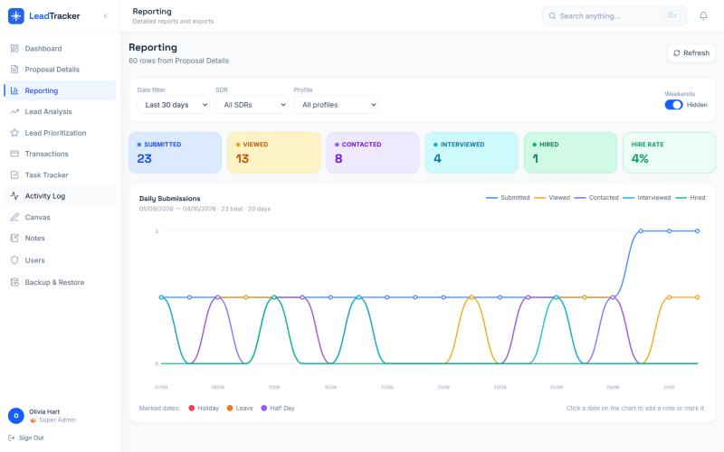

# Upwork Lead Tracker

A team dashboard for agencies and freelancers who win work on Upwork. Log every proposal, watch it move through the funnel from **Submitted** to **Hired**, see which profiles and team members convert best, and keep tasks, notes and spending in the same place.

Built with React, Vite, TypeScript, Tailwind CSS and Supabase. Deploys to Vercel as a static site.



## Features

| Module | What it does |
|---|---|
| **Dashboard** | Totals, this month vs last month, hire rate, the proposal funnel, top team members and profiles. |
| **Proposal Details** | A spreadsheet-style table with columns you can add, rename, resize and reorder. Import from CSV, export to CSV, filter by stage. Updates live for everyone on the team. |
| **Reporting** | Daily submissions per funnel stage over any date range, filtered by team member or profile. Mark holidays and leave on the chart. |
| **Lead Analysis** | A second table for researching leads, with columns that can link back to proposal data. |
| **Lead Prioritization** | Score leads that reached the Contacted stage or later against a checklist and sort them into High, Medium and Low tiers. |
| **Transactions** | Record payments and spending, with CSV export. |
| **Task Tracker** | Tasks with assignees, urgency, deadlines, subtasks, comments and history. |
| **Canvas** | A whiteboard for planning, including a ready-made funnel analysis template. |
| **Notes** | Colour-coded notes and a to-do list. |
| **Users & Activity Log** | Invite teammates as users or admins, and see who changed what. |
| **Backup & Restore** | Download everything as one JSON file and restore it in a single step. |

| Proposal Details | Reporting |
|---|---|
|  |  |

## Quick start

You need **Node.js 20+** and a free **[Supabase](https://supabase.com)** project.

```bash
git clone https://github.com/ansab-imam/upwork-lead-tracker.git
cd upwork-lead-tracker
npm install
cp .env.example .env.local     # add your Supabase URL and anon key
npm run dev
```

Before the first sign-in, set up the database:

1. In Supabase, open **SQL Editor → New query**, paste the whole of [`supabase/setup.sql`](supabase/setup.sql) and click **Run**. This creates the tables, security rules, backup functions and a starter set of proposal columns. It is safe to run more than once.
2. Go to **Authentication → Users → Add user**, enter an email and password and tick **Auto Confirm User**.
3. Open <http://localhost:5173> and sign in. The first person to sign in becomes the admin.

To add teammates from the **Users** page, also deploy the small `admin-users` edge function. [SETUP.md](SETUP.md) walks through every step, including deploying to Vercel, in plain language.

## Trying it with example data

[`sample-data/sample-proposals.csv`](sample-data/sample-proposals.csv) contains 25 fictional proposals. Go to **Proposal Details → Import**, choose the file, check the column matches and click import. The dashboard, funnel and reports fill in straight away.

## How the funnel works

Each proposal has a **Proposal Status**. The funnel counts a proposal at its own stage and every stage before it, so a proposal marked *Interviewed* also counts as *Viewed* and *Contacted*:

```text
Submitted → Viewed → Contacted → Interviewed → Hired
```

Conversion at each step is the share of proposals that made it from one stage to the next. That shows where you are losing clients: weak job selection shows up early, while closing problems show up between *Interviewed* and *Hired*.

## Configuration

| Variable | Purpose |
|---|---|
| `VITE_SUPABASE_URL` | Your project URL from Supabase → **Project Settings → API** |
| `VITE_SUPABASE_ANON_KEY` | The **anon / public** key from the same page |

The anon key is designed to be public. Access to data is controlled by the row-level security policies in `setup.sql`, so only signed-in users can read or write. Never use the `service_role` key in the browser.

## Project structure

```text
src/
  pages/            One file per module (Dashboard, Proposals, Reporting, Canvas, ...)
  components/       Tables, charts, modals and layout
  hooks/            Data hooks that read and write Supabase tables
  types/            Shared TypeScript types
supabase/
  setup.sql         Complete database setup (run once)
  migrations/       The same changes as individual migrations
  functions/        Edge function for adding and removing users
sample-data/        Fictional example proposals
```

## Scripts

| Command | What it does |
|---|---|
| `npm run dev` | Start the development server |
| `npm run build` | Type-check and build for production |
| `npm run preview` | Preview the production build |
| `npm run lint` | Lint the code |

## License

[MIT](LICENSE) © 2026 Socialist Fox
